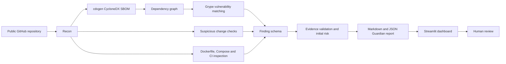

# Day 1 architecture

The orchestrator runs the agents in that order. Each run stores the cloned target,
SBOM, graph, raw Grype output when available, findings, status files, and reports in
`runs/<timestamp>/`. Every finding uses `guardian.schemas.Finding` and includes
evidence. Vulnerability findings include a graph path when Grype's package URL can
be matched to a graph node.

Groq is optional. Recon sends only filenames for unfamiliar manifest suggestions.
The evidence agent can generate prose for up to five findings; this prose does not
set risk levels. Scanner output and source files are the evidence sources.

## Scope and approval points

Day 1 observes and reports. It does not edit target code, build a fix, merge a pull
request, or deploy. A human reviews findings and approves any future remediation.
The Docker/CI agent inspects files statically. If `GUARDIAN_IMAGE_REF` names an
already-built local image and Trivy is installed, it also scans that image and
records a separate scan status. Guardian does not build or pull the image.
If Grype is missing or fails, the report says vulnerability matching was not run.

See [Responsible AI and security](responsible-ai.md) for data handling and limits.
