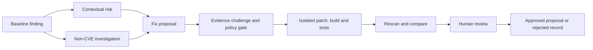

# Day 2: The Guardian's Brain and Shield

## Mission and demo scope

Take **one real, bounded finding** from detection to a reviewable remediation:
explain its priority, propose an exact change, test that change in an isolated
copy, rescan it, and present the evidence to a human reviewer. Investigate one
non-CVE suspicious change as a second case. Expand to more findings only after
this complete path works.

The outcome is a **verified proposal**, not an automatic merge or deployment.
The original repository and its default branch remain untouched. An automated
agent may prepare and test a patch in a disposable sandbox; a human must approve
the exact patch and results before any separate adoption step.

## Day 1 baseline that Day 2 builds on

Day 2 starts from the existing Guardian scan, not from a new detector. Recon
records the repository and commit; cdxgen supplies the CycloneDX SBOM; the graph
records components and dependency paths. Grype and optional Trivy supply
vulnerability observations and fixed-version hints. Suspicious-change and
Docker/CI checks provide non-CVE evidence. The Evidence and Risk Agent produces
initial severity-based ratings, while the Markdown/JSON report and Streamlit app
show the results. Day 2 consumes these saved artifacts and adds contextual
decisions, candidate changes, controlled validation, and before/after proof.
The Day 2 contract uses the saved evidence and status fields, so it does not
depend on how the Day 1 agents internally produced them.

The distinction matters: an advisory version is a **fix candidate**, and an
initial severity label is a **starting point for prioritization**. Neither is
already a tested remediation or a measured claim of exploitability.

## Problems the design must solve

| Problem | Day 2 fix | Proof that it worked |
| --- | --- | --- |
| Severity alone can overstate or understate application risk. | Person 1 records observed context and unknowns; the LLM challenges evidence but cannot invent reachability. | Every rank has factors and evidence references; unknown stays unknown. |
| A fixed transitive package version may not be installable through the application's direct dependencies. | Person 2 traces the owner with the graph and package manager, checks constraints, and proposes a bounded compatible change or `mitigation_only`. | Proposal names the direct owner, exact version source, constraint result, and changed files. |
| A demo target may build but lack runnable baseline application tests. | Person 4 trials the target first, then uses comparable baseline/candidate test environments or chooses a verified alternative. `npm audit` and `npm ls` stay diagnostic. | A passing candidate is supported by real application tests, or the result is `inconclusive`. |
| An LLM confidence number could be mistaken for permission to change code. | Require deterministic proposal gates; high confidence only permits an isolated sandbox attempt. Person 3 records final human approval of the exact patch. | No original-checkout edit, merge, or deployment occurs from confidence alone. |
| Five agents could exchange incompatible files or become stuck in many workflow states. | Freeze small versioned artifacts first, use five stages with independent outcomes, and log retries as events. | Each stage can read a fixture and produce a validated artifact independently. |
| Agent debate could produce confident but unsupported claims. | Limit it to one evidence challenge and rebuttal; record disagreements and send unresolved cases to review. | Each claim cites existing evidence; no vote can turn a failed test into a pass. |
| A build may run unsafe scripts or alter the host. | Person 4 uses a disposable workspace and constrained container, with no host secrets or Docker socket inside the target. | Only the candidate copy changes; commands, network access, and exit codes are logged. |
| A rescan can appear clean because a scanner was missing, settings changed, or finding IDs moved. | Person 5 compares equivalent coverage using stable finding keys and explicit `not_run`/`unverified` results. | Report separates resolved, remaining, new, and unverified findings with raw evidence links. |

## Five owners and handoffs

| Owner | Deliverable | Handoff condition |
| --- | --- | --- |
| **Person 1: Contextual Risk Agent** | Rank findings from observed severity, dependency ownership, and any measured exposure or reachability. Produce `risk_assessment.json` with score, confidence, evidence references, and unknowns. Use an LLM to explain or challenge the evidence, not to invent it. | Person 2 receives a ranked finding with traceable reasons. Unknown exposure or reachability stays unknown. |
| **Person 2: Remediation Agent** | Use advisory fixed-version hints and the dependency graph to find the actual manifest owner. Check version constraints; produce `proposal.json` and a bounded patch, or a clear `mitigation_only`/`manual_review` result. | Person 4 receives a specific patch, affected files, expected risk reduction, compatibility concern, rollback, and patch hash. |
| **Person 3: Suspicious Investigation and Approval Gate** | Investigate one non-CVE signal using repository evidence. Implement the decision policy and a simple review screen for `approve`, `reject`, or `request_changes`; record the human's decision. | The review record binds the reviewer, baseline commit, proposal ID, patch hash, validation result, and decision time. Person 5 can display it. |
| **Person 4: Sandbox Build and Test** | Apply the candidate only in an isolated workspace, then run comparable baseline/candidate builds and application tests. Capture the patch diff, commands, logs, tool versions, and outcomes in `validation.json`. | Person 5 receives `passed`, `failed`, or `inconclusive` with evidence. Missing tests or tools are never treated as a pass. |
| **Person 5: Rescan and Verification Report** | Rescan the candidate, compare it with baseline, and show resolved, remaining, new, and unverified findings. Produce `verification.json` plus a concise Day 2 report and a full evidence download. Integrate Person 3's review component into Streamlit. | A reviewer can inspect the exact change, build/test result, before/after risk, scan coverage, and approval record in one place. |

The five outputs above are the contracts between teammates. Person 3 owns the
approval **mechanism**; a human reviewer makes the decision. Person 5 owns the
report and app integration, including displaying the approval evidence.

## First task: freeze a small shared contract

Before implementing agents, agree on `guardian/schemas_day2.py` (or equivalent
validated models) and one example JSON file per stage. Avoid a single oversized
object that every person edits. All artifacts carry `schema_version`,
`repo_url`, `baseline_commit`, a `case_id` assigned from the baseline finding,
`created_at`, `status`, and paths to their source evidence. `proposal_id` is
assigned when Person 2 creates a proposal and is carried by later stages.
Stage-specific fields are:

| Artifact | Required fields |
| --- | --- |
| `risk_assessment.json` | `finding_key`, `source_finding_ids`, `score`, `risk_level`, `confidence`, `factors`, `unknowns`, `evidence_refs` |
| `investigation.json` | `finding_key`, `claim`, `observations`, `inferences`, `evidence_refs`, `confidence` |
| `proposal.json` | `finding_keys`, `action`, `target_files`, `from_version`, `to_version`, `constraint_check`, `patch_path`, `patch_sha256`, `rollback`, `proposal_confidence`, `evidence_refs` |
| `validation.json` | `baseline_commit`, `patch_sha256`, `environment`, `baseline_build`, `candidate_build`, `baseline_tests`, `candidate_tests`, `changed_files`, `logs`, `result` |
| `verification.json` | `baseline_scan`, `candidate_scan`, `resolved`, `remaining`, `new`, `unverified`, `coverage_differences`, `result` |
| `approval.json` | `proposal_id`, `baseline_commit`, `patch_sha256`, `decision`, `reviewer`, `reviewed_at`, `reason`; final adoption decisions also require `validation_ref` and `verification_ref` |

Use explicit enums and validation for status and action fields. Store files under
the run directory; do not overwrite baseline artifacts. A Day 1 ordinal ID such
as `VULN-001` may change after a rescan. Use a stable comparison key based on
advisory or check ID, canonical package identity **without its version**, source
detector, and affected artifact. Keep installed version as an observation. This
lets Person 5 recognize the same issue before and after an upgrade.

Keep orchestration simple: `assessed -> proposed -> sandboxed -> rescanned ->
reviewed`. Each stage separately records `completed`, `failed`, `inconclusive`,
or `not_run`; a stage name never means that its result passed. Log attempts and
retries as events, rather than adding many transition states. A changed baseline
commit or patch hash starts a new proposal and invalidates an old approval.

## Person 1: risk ranking with bounded AI reasoning

Use a deterministic score with recorded factors: advisory severity, whether the
dependency is direct or transitive, evidence that the affected component is used
in production, measured reachability/exposure, and suspicious/provenance signals.
An unknown factor contributes no invented fact. Show both **risk level** and
**confidence in that assessment**. No dependency path does not mean unreachable;
a CVE's severity does not prove exploitability in this app.

An LLM may provide a short evidence-cited challenge: "Which input supports this
rank? What is missing?" Require structured output with references to existing
evidence IDs. Reject unsupported IDs, versions, or claims of reachability. The
model's confidence number does not itself change a score. If the API is absent,
the deterministic assessment still works.

## Person 2: fix the right dependency, then challenge the proposal

Scanner `fixed_versions` are **candidate versions**, not a complete fix. Before
editing, use the dependency graph and ecosystem tool (for npm, `npm ls <package>`)
to identify the direct package that owns a vulnerable transitive dependency.
Check manifest and lockfile constraints, and whether a candidate can be resolved.
If no compatible upgrade exists, return `mitigation_only` or `manual_review` with
the reason. For a direct dependency, pin or upgrade only to a verified candidate
from advisory/package metadata. Do not let an LLM invent a version or shell command.

The patch generator should modify only listed files in a disposable workspace.
Begin with one finding or a small group sharing the same direct owner. Record a
unified diff and SHA-256 hash. Include a rollback instruction and a note about
possible API or behavior changes. The AI agent may draft the explanation and
propose a change, but structured validation and dependency tools decide whether
that proposal is eligible to test.

For the promised multi-agent reasoning, run **one bounded evidence challenge**
before sandboxing: Person 1 states the risk, Person 2 states fix feasibility, and
Person 3 checks suspicious-change context. The orchestrator stores each claim,
its evidence references, disagreement, and final disposition in
`reasoning_log.json`. It does not manufacture a consensus or let agents vote a
missing test into a pass. Unresolved disagreement lowers proposal eligibility
and goes to human review. One round and one short rebuttal are enough for the
demo; no open-ended agent debate.

## Confidence and human approval

Keep **risk confidence**, **proposal confidence**, and **validation result**
separate. Proposal confidence is based on verified signals: known fix source,
correct dependency owner, compatible constraints, narrow patch, and explicit
rollback. Treat an initial threshold such as `>= 0.85` as a configurable demo
gate, not a calibrated probability.

If required signals pass and proposal confidence meets the threshold, the system
may automatically try the patch **only inside Person 4's disposable sandbox**.
Low-confidence, no-fix, infrastructure-changing, or disputed proposals require
a recorded preflight human decision before any attempt. After the sandbox and rescan, **every** proposed
change still needs a human decision before it can be adopted. No confidence
threshold authorizes a write to the original checkout, a PR merge, or deployment.

Person 3's simple Streamlit review view should display the exact diff, source
finding, evidence challenge, confidence factors, build/tests, before/after scan,
remaining risk, and rollback. Buttons record `approve`, `reject`, or
`request_changes`; they do not apply the patch. Tie approval to `baseline_commit`
and `patch_sha256`, and invalidate it if either changes. A typed reviewer name is
only a declared identity in a demo; do not present it as authenticated approval
without an actual identity system.

## Person 4: sandbox that can give a meaningful answer

1. Create a fresh workspace at the recorded baseline commit. Keep the original
   repository read-only. Apply the proposal there and verify that only the
   allowed files changed.
2. Build and test both baseline and candidate in the **same pinned environment**.
   Run the application's actual build and tests, then record exit codes and logs.
   `npm audit` measures advisory findings and `npm ls` traces dependencies; neither
   substitutes for application tests.
3. Use an unprivileged, disposable container or equivalent isolation; do not
   pass host secrets or mount the Docker socket inside the target. Bound time,
   CPU, memory, disk, and network access. Record any network access needed to
   fetch dependencies and every command that was executed.
4. If baseline tests fail, choose a controlled test environment or a different
   demo target with runnable tests. Do not label a candidate as regression-free
   when the baseline could not be tested. A missing test suite, failed build, or
   timeout is `failed` or `inconclusive`, never `passed`.

Do not commit to a new demo repository just because its name sounds easier.
Select it only after a trial confirms a stable commit, reproducible install,
baseline build and tests, a small real fix candidate, and a reasonable scan time.
This is the first practical check before the five agents start in parallel.

## Person 5: rescan, compare, and tell the complete story

Scan baseline and candidate with matching tools, scanner settings, and recorded
database versions where possible. Compare SBOM packages, target finding keys,
new dependencies, Grype/Trivy results, suspicious changes, and container/CI
signals. Preserve both raw scanner records when they describe one underlying
issue. If coverage differs, mark the comparison `inconclusive` for the affected
category; never call an unscanned issue resolved.

The concise report should answer: what mattered, what changed, did it build and
pass application tests, did the target finding disappear, did new high risks
appear, what remains, and who approved or rejected the exact proposal? Keep full
evidence in JSON and logs. `resolved` requires a comparable after-scan;
`verified` additionally requires the required build/test gates to pass. Present
an honest `inconclusive` when any required evidence is missing.

## Integration order and definition of done

1. **Together:** choose and trial one reproducible demo target and freeze the
   artifact schemas, status enums, stable finding key, and one success fixture.
2. **People 1–3:** produce risk, investigation, fix proposal, and the bounded
   evidence challenge. Review a real transitive dependency case and a no-fix case.
3. **Person 4:** implement the isolated baseline/candidate build and test runner.
   Hand Person 5 a complete validation record, including failures.
4. **Person 5:** rescan, compare, and produce the concise report. Person 3 wires
   the review decision to Person 5's display and artifact links.
5. Integrate the stages. Demonstrate a successful candidate **and** a blocked
   candidate. Keep the blocked one visibly unapproved.

The demo succeeds when a reviewer can trace the original finding to its evidence,
understand the risk and exact patch, reproduce the sandbox result, see a comparable
before/after scan, and make an informed decision. Any missing proof appears as
`inconclusive` with a reason, not as success.
